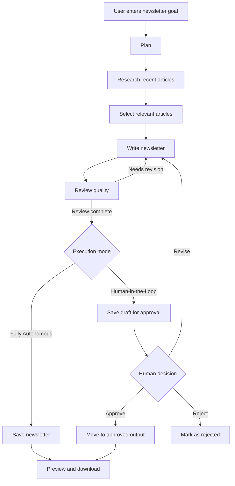

# AI Newsletter Agent

An AI-powered autonomous newsletter generation system that researches recent news, selects relevant articles, writes a newsletter, reviews its quality, and prepares it for publishing. Built with **Python, Streamlit, LangGraph, Google Gemini/Gemma, and Tavily Search**.

The project supports both fully autonomous newsletter generation and a human-in-the-loop workflow, allowing users to review and approve content before publishing.

## Features

- **Autonomous Planning:** Creates a plan based on the user's newsletter goal.
- **Web Research:** Uses Tavily Search to discover recent and relevant articles.
- **Article Selection:** Selects relevant stories and validates their source URLs.
- **AI Newsletter Writing:** Generates a structured newsletter with headlines, summaries, and source links.
- **Quality Review:** Evaluates the newsletter and requests revisions when necessary.
- **Human-in-the-Loop:** Supports reviewing, approving, rejecting, and revising newsletter drafts.
- **Automatic Saving:** Stores newsletter drafts, approved newsletters, and metadata locally.
- **Multiple Download Formats:** Download the generated newsletter as HTML, PDF, or Word, depending on the configured download utilities.
- **Interactive UI:** Provides a Streamlit interface to run the agent, preview content, and manage approval.
- **Demo Mode:** Supports testing the interface with sample content without making AI or search API calls, when enabled.

## Tech Stack

| Technology | Purpose |
|---|---|
| Python | Core application logic |
| Streamlit | Interactive web interface |
| LangGraph | Agent workflow orchestration |
| LangChain | LLM integration |
| Google Gemini / Gemma | Content generation and review |
| Tavily Search API | Web research |
| Pydantic | Structured data validation |
| python-dotenv | Environment variable management |
| python-docx | Word document generation |
| xhtml2pdf / ReportLab | PDF generation, depending on implementation |

## Project Structure

```text
AI-newsletter-agent/
├── app.py                  # Streamlit application
├── agent.py                # Agent workflow, research, writing, and review
├── download_utils.py       # HTML, PDF, and Word download utilities
├── .env                    # API keys (not committed to Git)
├── .gitignore
├── requirements.txt        # Python dependencies
└── output/
    ├── drafts/             # Pending newsletter drafts
    └── approved/           # Approved newsletters
```

Additional files, such as a sample newsletter for demo mode, may be included depending on your implementation.

## How It Works

The agent follows a multi-stage workflow orchestrated with LangGraph:



### Execution Modes

**1. Fully Autonomous**

- Plans the task and researches recent news.
- Selects articles and generates the newsletter.
- Reviews the generated content and revises it when needed.
- Saves the final output without requiring manual approval.

**2. Human-in-the-Loop**

- Generates and reviews a newsletter draft.
- Saves the draft for human review.
- Allows the user to approve, reject, or request revisions.
- Makes the approved newsletter available for download.

## Prerequisites

- Python 3.11 or a compatible Python version.
- A Google AI API key for the configured Gemini/Gemma model.
- A Tavily API key for web research.
- Internet access when using the live agent.

API availability, quotas, and supported model names depend on your provider account and configuration.

## Installation

### 1. Clone the repository

```bash
git clone <YOUR_GITHUB_REPOSITORY_URL>
cd AI-newsletter-agent
```

Replace the repository URL with your GitHub repository URL.

### 2. Create a virtual environment

**Windows:**

```bash
python -m venv .venv
.venv\Scripts\activate
```

**macOS / Linux:**

```bash
python3 -m venv .venv
source .venv/bin/activate
```

### 3. Install dependencies

```bash
python -m pip install --upgrade pip
pip install -r requirements.txt
```

### 4. Configure environment variables

Create a `.env` file in the project root:

```env
GOOGLE_API_KEY=your_google_ai_api_key
TAVILY_API_KEY=your_tavily_api_key
```

Replace the placeholder values with your own API keys.

**Security:** Never commit your `.env` file or expose your API keys in screenshots, logs, or public repositories.

### 5. Run the application

```bash
streamlit run app.py
```

Open the local URL printed by Streamlit, usually:

```text
http://localhost:8501
```

## Usage

1. Open the Streamlit application.
2. Enter a newsletter goal, such as:

   ```text
   Create a weekly newsletter covering the latest AI agent news.
   ```

3. Choose **Fully Autonomous** or **Human-in-the-Loop** mode.
4. Run the Newsletter Agent.
5. Review the research results, generated newsletter, and quality feedback.
6. In Human-in-the-Loop mode, approve the draft, request revisions, or reject it.
7. Download the newsletter in a supported format.

## Configuration

The agent's behavior can be adjusted in `agent.py`.

| Setting | Purpose |
|---|---|
| `MAX_REVISIONS` | Maximum number of automated revision attempts |
| `MIN_ARTICLES` | Minimum number of selected articles |
| `MAX_ARTICLES` | Maximum number of selected articles |
| `OUTPUT_DIR` | Root directory for generated files |
| `DRAFT_DIR` | Directory for pending drafts |
| `APPROVED_DIR` | Directory for approved newsletters |
| `model` | Configured Google AI model |

The model name must be supported by your Google AI API account. Update the configured model if it becomes unavailable or repeatedly returns server errors.

## Output

The agent saves newsletter content and associated metadata locally.

Typical outputs include:

- **HTML newsletter:** A previewable newsletter with formatting and source links.
- **JSON metadata:** Information about the run, selected articles, review feedback, revision count, and status.
- **PDF download:** A shareable document version.
- **Word download:** An editable document version.

The exact filenames and output locations depend on the application's saving logic.

## Demo Mode and Testing

Demo mode can be used to test the Streamlit interface without repeatedly consuming API quota, provided it is implemented and enabled in `app.py`.

For testing:

- Use sample newsletter content to verify the preview.
- Test the HTML download.
- Test PDF and Word generation separately.
- Verify the human approval, rejection, and revision interface.
- Use live API calls only when testing the complete research and generation workflow.

A local PDF test script can also validate pagination and layout without invoking the AI agent, provided it calls only the local PDF-generation utility.

## Error Handling and Limitations

- Live research and generation require valid API keys and available API quotas.
- AI providers may return temporary errors, including HTTP 429 or 5xx responses.
- Article availability and search results depend on the search provider.
- Source URL validation does not guarantee that an article's claims are accurate.
- Human approval is handled by the application's UI and file-management logic.
- Demo mode uses sample content and should not be treated as a live news newsletter.
- Newsletter quality depends on the retrieved sources, model output, and review logic.

## Future Improvements

- Add email delivery through an email provider.
- Schedule newsletters to run automatically every week.
- Add stronger source verification and duplicate-story detection.
- Track newsletter history and approval decisions.
- Add configurable topics, audiences, and writing styles.
- Improve retry handling for model and search API failures.
- Add automated tests for workflow nodes and document downloads.
- Deploy the application to a cloud hosting platform.

## License

Add a license file if you intend to distribute this project publicly. Until a license is specified, reuse and redistribution are subject to applicable copyright rules.
